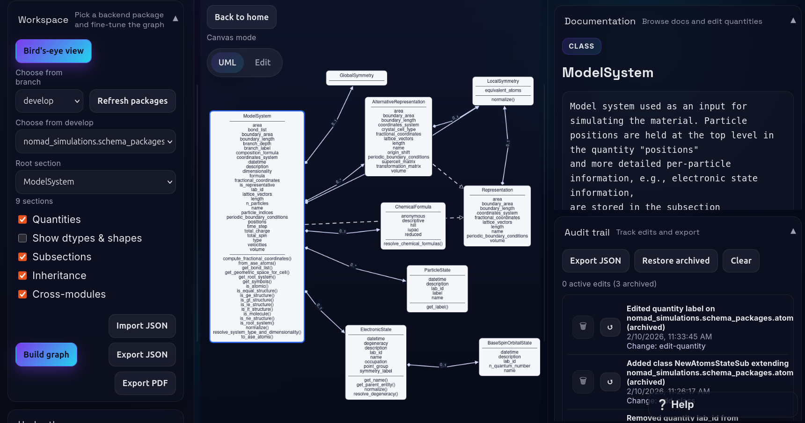

# Schema Studio

Interactive schema explorer and editor for data models.

Schema Studio runs in two ways:
- **Static site**: runs entirely in the browser, without a server. The Python
  core runs in the browser with [Pyodide](https://pyodide.org); edits stay in
  that browser. This is what GitHub Pages serves, and how you run it locally.
- **Dev Mode**: a FastAPI server with MongoDB and Celery, for sign-in, branch
  switching, branch comparison and edits stored on the server.

Both show the same layout; Dev Mode only adds what needs its server.
Schema families: `nomad-simulations`, `nomad-measurements` and `bam-masterdata`.

Back end: **FastAPI** (Dev Mode) and **Pyodide** (static site)  
Front end: **React + Cytoscape + ELK**  
Python: **3.11+**



## Quick Start (from source)

### 1) Install

Clone and enter in the project folder:

```bash
git clone https://github.com/EBB2675/schema-studio.git
cd schema-studio
```

Install the Python dependencies with [`uv`](https://docs.astral.sh/uv/), and the
frontend dependencies with npm:

```bash
uv sync
npm --prefix web ci
```

### 2) Set up the schema environments

Schema Studio does not install any schema package next to itself. Each schema
family lives in its own small environment under `environments/<profile>/`, and
the app reads a schema by running a script with that environment's Python.
This needs `uv` on your `PATH`.

Set up the ones you want to browse (run from the repository root):

```bash
uv sync --project environments/nomad-simulations    # tracks `develop`
uv sync --project environments/nomad-measurements   # tracks `main`
uv sync --project environments/bam-masterdata       # tracks `main`
```

The two NOMAD environments install `nomad-lab` and are large downloads.

### 3) Build and run

```bash
npm --prefix web run build:pages                                        # frontend + Pyodide into web/dist
.venv/bin/python scripts/build_snapshots.py --out web/dist/data --graphs  # schema snapshots of every set-up profile
mkdir -p /tmp/site && rm -rf /tmp/site/schema-studio && cp -r web/dist /tmp/site/schema-studio
cd /tmp/site && python -m http.server
```

Open `http://localhost:8000/schema-studio/`. The site is built to be served
under `/schema-studio/` (set by `web/.env.pages`), which is why it is copied
into a folder of that name.

### 4) First-use flow
1. Pick a schema family.
2. Pick a package.
3. Pick a root section (or leave empty for all sections).
4. Click **Build graph**.
5. Click classes/quantities to view docs and metadata.
6. Toggle **Editable mode** to add classes/quantities.

## What You Get

- UML-style class cards (sections) with quantities and relationships
- Class + quantity documentation panel
- Under-the-hood usage panel (normalizers/helpers)
- Bird's-eye package/class overview
- Editable graph (add classes, add/rename/remove quantities)
- JSON, LinkML and PDF export

## Static Site vs Dev Mode

| Capability | Static site | Dev Mode |
|---|---|---|
| Run with | built site + any static file server | Docker Compose (or local services) |
| Server | none (Python core in the browser) | FastAPI |
| Auth | No | Yes |
| Multi-user | No | Yes |
| Branch switching/diff | No (the snapshot's branch) | Yes |
| Edits stored in | this browser (download/load as JSON) | MongoDB |
| Background jobs | Not required | Celery + Redis |

## Configuration

These variables apply to reading schemas from the environments, in Dev Mode and
in `scripts/build_snapshots.py`.

| Variable | Default | Purpose |
|---|---|---|
| `SCHEMA_STUDIO_HOME` | platform config dir | Where cached schema reads are kept |
| `SCHEMA_STUDIO_ENVIRONMENTS_DIR` | `environments/` in the checkout | Folder that holds the schema environments |
| `SCHEMA_STUDIO_SCHEMA_PROFILE` | `nomad-simulations` | Profile used when a package belongs to none |
| `SCHEMA_STUDIO_EXTRACTOR_TIMEOUT_SECONDS` | `300` | Time limit for one schema read in an environment |
| `SCHEMA_STUDIO_EXTRACTION` | `linkml` | How graphs, roots and usage info are built: `linkml` (from the LinkML snapshot) or `legacy` (graph builder in the schema environment). One value for all profiles, or per profile, e.g. `nomad-simulations=legacy` or `bam-masterdata=legacy`; profiles not named use `linkml`. Dev Mode reads it for graphs (including branch graphs), roots and usage; its overview and package list scan the git worktree instead. |

The static site is configured at build time in `web/.env.pages` (`VITE_STATIC_MODE`, `VITE_BASE_PATH`).

### Data location
Cached schema reads are kept in:
- `$SCHEMA_STUDIO_HOME/cache/` (if `SCHEMA_STUDIO_HOME` is set), or
- `cache/` in your platform config directory (`schema_studio`; fallback: `./.schema_studio/`).

The static site keeps its edits in the browser's local storage.

## Keeping Schemas Fresh

Each environment is pinned by its `uv.lock`. To move one to the latest commit
of its branch, run:

```bash
uv lock --project environments/bam-masterdata --upgrade-package bam-masterdata
uv sync --project environments/bam-masterdata
```

This is the only step that installs anything, and it only touches
`environments/<profile>/`. A schema environment is never created or updated as a
side effect of building a graph. For the static site, run
`scripts/build_snapshots.py` again afterwards; the snapshots are built for the
commit each environment holds.

## Common Issues

### Requests answer `503`
The schema family's environment is not set up yet. Set it up as described in
[Set up the schema environments](#2-set-up-the-schema-environments).

### `ImportError: cannot import name 'model_validator'`
You are likely on an older Pydantic install. Use a clean Python 3.11+ environment and reinstall.

## Dev Mode (Full Stack) Quick Start

Use this if you need auth, multi-user, branch diff, Mongo, and Celery.

```bash
git clone https://github.com/EBB2675/schema-studio.git
cd schema-studio
cp .env.example .env
# set SCHEMA_UML_REPO_HOST, SCHEMA_UML_SECRET, SCHEMA_UML_PW_SALT
# SCHEMA_PROFILES lists the schema environments built into the API image
docker compose up --build -d
```

Open `https://localhost`.

## Local Source Development Notes

- Backend deps: `api/requirements.txt` (Dev Mode, including MongoDB and Celery clients)
- Frontend: `npm --prefix web run dev` starts the Vite dev server against a Dev Mode API at `http://localhost:5179` (`VITE_API_BASE`).

## Desktop App

Schema Studio also has a Tauri-based desktop packaging path for Light Mode.

Current desktop characteristics:

- native Tauri window
- packaged Python backend sidecar
- self-contained Windows installer support
- first-pass Linux `.deb` packaging support
- first-pass macOS `.app` / `.dmg` packaging support


For desktop-specific setup, testing, packaging, and maintenance notes, use the dedicated docs:

- [Desktop Light Mode](docs/desktop-light-mode.md)
- [Schema Profiles](docs/schema-profiles.md)
- [Desktop Mode Extension](docs/desktop-mode-extension.md)
- [Desktop Roadmap](docs/desktop-roadmap.md)
- [BAM Schema Selection Plan](docs/bam-schema-selection-plan.md)

## Static Site (GitHub Pages)

The static site needs no server. Compared with Dev Mode:

- the schemas are snapshot files built into the site, one per schema module, for the commits shown when hovering over each schema family button;
- graphs, edits, usage info and the LinkML download are computed in the browser by the same Python code the server runs, with [Pyodide](https://pyodide.org) in a web worker; the first graph of each module comes ready-made, so it shows before Pyodide has loaded;
- edits are stored only in that browser; "Download edits" and "Load edits" move them between browsers;
- branches, branch comparison and login need a server and are not offered.

The workflow `.github/workflows/pages.yml` builds and publishes it when a release is published, or when started by hand. To build and run it locally, see [Build and run](#3-build-and-run).

## API (Dev Mode)

Core endpoints (all but the auth ones need a signed-in user):
- `POST /auth/login`, `POST /auth/register`
- `GET /workspace`, `PUT /workspace`
- `GET /roots`, `GET /schema`, `GET /overview`, `GET /usage`
- `GET /schema/edits`, `POST /schema/edits`, `DELETE /schema/edits`, `DELETE /schema/edits/{id}`
- `GET /schema/linkml` (with the module's edits unless `edits=false`), `GET /schema/linkml/report`
- `GET /git/branches`, `GET /git/packages`, `POST /graph`, `POST /graph/diff`, `/tasks/*`

The static site answers the same requests in the browser (`web/src/static/backend.ts`), except those that need the server.

## Authors

**[Dr. Esma B. Boydas](https://github.com/EBB2675)**  
Humboldt-Universität zu Berlin / FAIRmat-NFDI

**[Dr. Jose M. Pizarro](https://github.com/JosePizarro3)**  
Bundesanstalt fur Materialforschung und -prüfung (BAM)  
Original idea and technical guidance.


## License

SchemaStudio is licensed under the MIT License. Third-party dependencies are subject to their own respective licenses.
